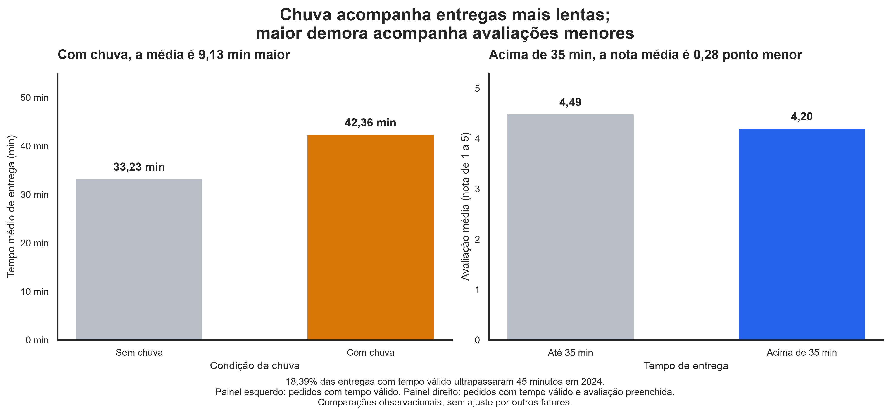

# Diagnóstico dos pedidos de delivery em 2024

> Análise da operação, das avaliações dos clientes e da relação de chuva e cupons com os pedidos para apoiar o planejamento de 2025.

# Chuva acompanha entregas mais lentas e maior demora acompanha avaliações menores

> O prazo de entrega merece atenção no planejamento de 2025. As entregas com chuva demoraram, em média, 9,13 minutos a mais. A empresa deve testar melhorias na operação e acompanhar os atrasos e a satisfação dos clientes.




*Pedidos de 2024. À esquerda, tempo médio com e sem chuva; à direita, avaliação média até e acima de 35 minutos. Foram considerados tempos válidos e, no painel de avaliação, pedidos com nota preenchida.*

---
## 1. Pergunta de negócio

A diretoria do aplicativo de delivery pediu um diagnóstico dos pedidos de 2024 para apoiar o planejamento de 2025. A análise investigou a operação das entregas, o comportamento e as avaliações dos clientes e a relação de cupons e chuva com o negócio.

**Perguntas que guiaram a análise**

1. Em quais combinações de dia da semana e horário se concentram mais pedidos e entregas mais demoradas?
2. Pedidos que demoram mais para chegar tendem a receber notas mais baixas?
3. Os tipos de cozinha com entregas mais rápidas também têm as melhores avaliações?
4. Qual é a diferença no valor médio entre pedidos com e sem cupom para clientes novos e para os demais?
5. Pedidos com taxa de entrega mais alta tendem a receber notas mais baixas?

## 2. Dados

- **Fonte** — `delivery_pedidos.csv`, base simulada fornecida no módulo DS-PY-018.
- **Período e escopo** — 01/01/2024 a 31/12/2024, em São Paulo, Rio de Janeiro e Belo Horizonte.
- **Tamanho** — 8.058 linhas × 18 colunas na base original e 8.058 linhas × 23 colunas na base limpa.
- **Unidade de observação** — um pedido.

### Dicionário da base limpa

Arquivo publicado em `saidas/delivery_pedidos_limpo.csv`. Os tipos abaixo representam a base tratada no notebook. Ao carregar o CSV, datas e categorias precisam ser reconstruídas.

| Coluna | Tipo | Descrição | % faltantes | Observação / tratamento |
|---|---|---|---:|---|
| `pedido_id` | inteiro | Identificador do pedido | 0,00 | Sem identificadores repetidos |
| `data_hora` | datetime | Data e hora do pedido | 0,00 | Convertida de texto |
| `cidade` | texto | Cidade de entrega | 0,00 | 13 grafias padronizadas para 3 cidades |
| `bairro` | texto | Bairro de entrega | 0,00 | Preservado |
| `restaurante_id` | texto | Código do restaurante | 0,00 | Preservado como texto, como R912 |
| `tipo_cozinha` | texto | Categoria de cozinha | 0,00 | Seis categorias |
| `plataforma` | texto | Plataforma usada no pedido | 0,00 | 153 faltantes preenchidos com “Não informada” |
| `forma_pagamento` | texto | Meio de pagamento | 0,00 | Oito grafias padronizadas para quatro categorias |
| `cupom` | booleano | Indica uso de cupom | 0,00 | Sim convertido para True e Não para False |
| `cliente_novo` | booleano | Indica primeiro pedido do cliente | 0,00 | True representa cliente novo |
| `chuva` | booleano | Indica chuva na cidade naquele dia | 0,00 | Condição compartilhada por cidade-dia |
| `distancia_km` | decimal | Distância entre restaurante e cliente, em km | 4,00 | 315 faltantes originais e 7 valores acima de 100 km tratados como ausentes |
| `tempo_entrega_min` | decimal | Tempo entre pedido e entrega, em minutos | 0,41 | 25 códigos 999 e 8 tempos negativos tratados como ausentes |
| `valor_pedido` | decimal | Valor dos itens em reais, sem taxa | 0,00 | Formatos monetários padronizados antes da conversão |
| `taxa_entrega` | decimal | Taxa cobrada em reais | 0,00 | Zero representa frete grátis |
| `avaliacao` | decimal | Nota de 1 a 5 | 16,65 | 1.342 avaliações ausentes foram mantidas |
| `data` | data | Dia do pedido | 0,00 | Extraída de data_hora |
| `mes` | inteiro | Mês do pedido, de 1 a 12 | 0,00 | Extraído de data_hora |
| `hora` | inteiro | Hora do pedido, de 0 a 23 | 0,00 | Extraída de data_hora |
| `dia_semana` | categoria ordenada | Dia da semana | 0,00 | Ordem de Seg a Dom |
| `tempo_invalido` | booleano | Flag de tempo inválido | 0,00 | True para tempo original negativo ou igual a 999 |
| `distancia_invalida` | booleano | Flag de distância inválida | 0,00 | True para distância original acima de 100 km |
| `pedido_grande` | booleano | Flag de pedido grande | 0,00 | True quando o valor supera quatro vezes a mediana da sua cozinha |

## 3. Como rodar

Os comandos abaixo consideram Windows PowerShell, notebook na raiz e a base original em `dados/delivery_pedidos.csv`.

Execute um comando por vez:

```powershell
git clone https://github.com/deborabaldeznilo/projeto-delivery.git
cd projeto-delivery
python -m venv .venv
.\.venv\Scripts\python.exe -m pip install -r requirements.txt
.\.venv\Scripts\python.exe -m notebook projeto_final.ipynb
```

No notebook, confira se o caminho da base está configurado assim:

```python
DADOS = "dados/"
```

No menu Kernel, selecione a opção de reiniciar o kernel e executar todas as células. Ao terminar, confira se não houve erros e se os arquivos de saída foram gerados na pasta `saidas`.

## 4. Estrutura do repositório

| Caminho | Conteúdo |
|---|---|
| `README.md` | Apresentação do projeto, resultados e instruções |
| `requirements.txt` | Dependências com as versões utilizadas |
| `projeto_final.ipynb` | Análise e respostas das Etapas 1 a 11 |
| `autoavaliacao.md` | Autoavaliação, a incluir quando preenchida |
| `dados/delivery_pedidos.csv` | Base original preservada |
| `saidas/delivery_pedidos_limpo.csv` | Base tratada |
| `saidas/figura_principal.png` | Figura principal salva em 300 dpi |

## 5. Metodologia

1. **Perguntas e hipóteses** — Foram definidas cinco perguntas de negócio e seis hipóteses, incluindo a relação entre taxa de entrega e avaliação.
2. **Carga e inspeção** — Foram verificados tipos, faltantes, categorias, valores suspeitos e duplicidades antes do tratamento.
3. **Limpeza** — Foram removidas duas colunas constantes, convertidos os tipos e padronizadas cidades e formas de pagamento, preservando as 8.058 linhas.
4. **Outliers** — Foram tratados 33 tempos inválidos e 7 distâncias impossíveis. Os 26 pedidos classificados como grandes foram mantidos.
5. **Estatística descritiva** — Foram calculadas medidas de posição e dispersão. A mediana foi escolhida para representar o ticket típico.
6. **Sumarização e granularidade** — Foram comparados pedidos, cidades, cozinhas, dias, semanas, meses e cidade-dias. Semanas incompletas foram identificadas.
7. **Visualização** — Foram usados títulos com conclusões, unidades nos eixos, cores consistentes e identificação dos valores fora das ampliações.
8. **Correlação** — Foram comparados Pearson e Spearman. A separação do frete grátis revelou uma relação quase perfeita entre taxa positiva e distância.
9. **Testes de hipótese** — Foram usados Mann–Whitney, Spearman, Kruskal–Wallis e qui-quadrado, com alfa de 5%, além de ANOVA complementar e tamanhos de efeito.
10. **Conclusões** — Foram selecionados cinco achados, três recomendações e limitações para apoiar o planejamento de 2025.


### Decisões de limpeza

A base original foi preservada, e a limpeza foi feita na cópia `df`.
As quantidades abaixo podem se sobrepor, pois um pedido pode apresentar
mais de um problema.

| Problema | Linhas afetadas | Decisão | Alternativa considerada |
|---|---:|---|---|
| País e moeda constantes | 8.058 linhas em cada coluna | Remover as duas colunas, pois não apresentam variação | Manter as colunas |
| Data e hora como texto | 8.058 | Converter para datetime e criar as colunas de data, mês, hora e dia da semana | Converter somente durante cada análise |
| Grafias diferentes de cidade | 997 valores alterados | Padronizar para São Paulo, Rio de Janeiro e Belo Horizonte | Manter as grafias originais |
| Grafias diferentes de pagamento | 666 valores alterados | Padronizar para quatro formas de pagamento | Manter as grafias originais |
| Formatos monetários que falharam na conversão direta | 720 | Padronizar o texto e converter todos os valores para número, sem criar faltantes | Tratar as falhas de conversão como ausentes |
| Cupom como texto | 8.058 | Converter `Sim` para `True` e `Não` para `False` | Manter como texto |
| Plataforma ausente | 153 | Preencher com “Não informada”, sem presumir qual plataforma foi usada | Preencher com a plataforma mais frequente |
| Avaliação ausente | 1.342 | Manter ausente após investigar os faltantes e usar as notas preenchidas nas análises | Preencher com média ou mediana |
| Distância ausente na base original | 315 | Manter ausente | Estimar pela taxa de entrega, possibilidade investigada na Tarefa 8.3 |
| Tempo de entrega negativo ou igual a 999 | 33 | Substituir por `NaN` e criar a flag `tempo_invalido` | Remover o pedido inteiro |
| Distância acima de 100 km | 7 | Substituir por `NaN` e criar a flag `distancia_invalida` | Remover o pedido inteiro |
| Pedidos acima de quatro vezes a mediana da sua cozinha | 26 | Manter os valores e criar a flag `pedido_grande`, pois foram considerados pedidos grandes plausíveis | Excluir os valores extremos |

Após o tratamento das sete distâncias inválidas, a coluna `distancia_km` ficou com **322 valores ausentes**: 315 que já estavam ausentes e sete identificados na limpeza.

Não foram encontradas linhas totalmente duplicadas nem identificadores de pedido repetidos. **Todas as 8.058 linhas foram preservadas.**

## 6. Principais achados


*À esquerda, tempo médio de entrega com e sem chuva. À direita,
avaliação média até e acima de 35 minutos. Foram considerados
tempos válidos e, no painel de avaliação, notas preenchidas.*

1. **Com chuva, as entregas demoraram em média 9,13 minutos a mais.** O tempo médio foi de 42,36 minutos com chuva e 33,23 sem chuva, conforme as Tarefas 6.8 e 9.1, com Mann–Whitney. A diferença deve ser considerada no planejamento da operação e dos prazos em dias chuvosos.

2. **Entregas acima de 35 minutos receberam avaliação média aproximadamente 0,28 ponto menor.** A média foi de 4,20, contra 4,49 nas entregas até 35 minutos. O resultado veio das Tarefas 7.7 e 9.3, com Spearman e Mann–Whitney. Isso reforça a importância de acompanhar a demora junto da satisfação.

3. **Uma promessa de entrega em até 45 minutos teria sido descumprida em 1.476 pedidos.** Isso representa 18,39% dos 8.025 pedidos com tempo válido, conforme a Tarefa 5.4. O percentual ajuda a avaliar se a promessa está de acordo com a capacidade operacional.

4. **Em julho, o uso de cupons chegou a 45,62% e o movimento atingiu 26,52 pedidos por dia, contra 21 em junho.** O resultado veio das Tarefas 6.7 e 7.8. O aumento coincidiu com a campanha, mas sua avaliação também precisa considerar custos e retorno.

5. **O ticket mediano variou de R$ 38,42 em Doces a R$ 107,97 em Japonesa.** A diferença foi de R$ 69,55, conforme as Tarefas 6.3 e 9.4. Kruskal–Wallis identificou uma diferença global entre cozinhas. Por isso, metas de ticket devem considerar a categoria.

### Hipóteses testadas — α = 5%

| Hipótese | Teste principal | p-valor | Efeito | Decisão | Em linguagem de negócio |
|---|---|---|---|---|---|
| H1 — Chuva × tempo | Mann–Whitney unilateral | 6,21 × 10⁻²⁵⁶ | +9,13 min na média | Rejeitar H0 | Com chuva, o tempo foi maior |
| H2 — Cupom × ticket | Mann–Whitney bilateral | 3,19 × 10⁻¹⁴ | −R$ 5,60 na mediana com cupom | Rejeitar H0 | Pedidos com cupom tiveram menor ticket típico |
| H3 — Tempo × avaliação | Spearman unilateral | 7,75 × 10⁻⁹² | rho = −0,2444 | Rejeitar H0 | Maior demora acompanhou notas menores |
| H4 — Cozinha × ticket | Kruskal–Wallis | Abaixo da precisão numérica | η² da ANOVA = 0,1512 | Rejeitar H0 | Há diferença global no ticket entre cozinhas |
| H5 — Cidade × pagamento | Qui-quadrado | 0,6951 | V de Cramér = 0,0155 | Não rejeitar H0 | Sem evidência suficiente de associação |
| H6 — Taxa × avaliação | Spearman unilateral | 1,92 × 10⁻¹⁹ | rho = −0,1088 | Rejeitar H0 | Associação negativa fraca, menos evidente dentro das faixas de tempo |

A ANOVA complementar de H4 apresentou F = 286,82 e p-valor de aproximadamente 2,94 × 10⁻²⁸³. O eta-quadrado representa a parcela da variação do ticket associada às diferenças entre as médias das cozinhas. 

Como contraste em H5, cupom × cliente novo apresentou qui-quadrado de 435,30, p-valor de aproximadamente 1,14 × 10⁻⁹⁶ e V de Cramér de 0,2324. Foram usados testes sem correção de continuidade. Clientes novos representaram 34,35% dos pedidos com cupom e 12,81% dos sem cupom.

Em H6, a análise por faixas de tempo apresentou rho de 0,0309 até 35 minutos, 0,0079 acima de 35 até 45 minutos e −0,0740 acima de 45 minutos. As duas primeiras faixas não apresentaram evidência da associação negativa proposta. Na última, a associação foi muito pequena.

Os p-valores foram avaliados individualmente, sem ajuste para múltiplos testes. As comparações complementares são exploratórias. H1 também apresenta limitação porque pedidos da mesma cidade-dia compartilham a chuva. Significância estatística e importância prática foram interpretadas em conjunto.

## 7. Recomendações

| Nº | Recomendação | Achados que sustentam | Métrica para acompanhar |
|---|---|---|---|
| 1 | Testar reforço de entregadores em dias chuvosos e nos horários de maior demanda, começando por sextas e sábados no almoço e jantar | Chuva associada a mais 9,13 min e 18,39% das entregas acima de 45 min; picos das Tarefas 6.6 e 7.5 | Percentual acima de 45 min e tempo mediano, por chuva, dia e horário |
| 2 | Testar um alerta para pedidos próximos de 35 minutos, verificando atrasos com o restaurante e atualizando a previsão para o cliente | Avaliação média aproximadamente 0,28 ponto menor acima de 35 min | Percentual acima de 35 min, avaliação média e taxa de resposta, comparando piloto e grupo de comparação |
| 3 | Testar a próxima campanha de cupons com grupos sorteados com e sem oferta, acompanhando custos e compras posteriores | Julho teve maior uso de cupons e aumento do movimento | Pedidos por cliente, margem após incentivo e recompra em 30 dias, com coleta de identificação e custos |

## 8. Limitações

- Os dados mostram relações, mas não permitem afirmar que uma coisa causou a outra. Não podemos atribuir o aumento de julho somente aos cupons.
- A base não tem um código para identificar cada cliente. Por isso, não conseguimos acompanhar recompra ou fidelização.
- Faltam os custos dos pedidos e descontos. Assim, não conseguimos calcular o lucro ou o retorno financeiro da campanha.
- Nem todos os clientes avaliaram os pedidos. As notas podem não representar a opinião de quem não respondeu.
- Alguns pedidos ficaram sem distância ou com tempo inválido. Esses valores ficaram fora dos cálculos que dependiam dessas informações.
- A base cobre somente 2024. Precisaríamos de outros anos para verificar se os padrões se repetem.
- Pedidos da mesma cidade-dia ou restaurante podem compartilhar condições. Os testes por pedido não consideram completamente essa dependência.
- Os dados são simulados para o curso. As conclusões se referem a essa base e precisam ser verificadas antes de aplicação em uma operação real.

## 9. Próximos passos

- Registrar um identificador de cliente e acompanhar a recompra após o uso de cupons.
- Incluir custos, descontos e comissões para avaliar margem e retorno das campanhas.
- Testar as melhorias operacionais e comparar os resultados com um grupo de comparação.
- Repetir a análise com outros anos para investigar sazonalidade e crescimento.
- Investigar a ausência de avaliações e melhorar a coleta das informações de tempo e distância.
- Avaliar métodos que considerem o agrupamento dos pedidos por cidade-dia e restaurante.
- Validar a possibilidade de estimar distâncias ausentes pela taxa positiva, identificando os valores estimados separadamente.

## 10. Autores

| Nome | GitHub | Principais contribuições |
|---|---|---|
| Débora Araujo Baldez Nilo | @deborabaldeznilo | Perguntas de negócio, inspeção, limpeza, análise, visualizações, testes e comunicação dos resultados |

### Validação da execução

O projeto foi testado em um clone do repositório, com ambiente virtual novo e as dependências do `requirements.txt`. Todas as células do notebook foram executadas do início ao fim, sem erros.

- **Data do teste:** 09/11/2026.
- **Python:** 3.14.7.
- **Bibliotecas:** versões registradas no `requirements.txt`.
- **Tempo da execução completa:** 28 seconds.

*Projeto final do módulo DS-PY-018 · Análise Exploratória de Dados · Novembro de 2026*
